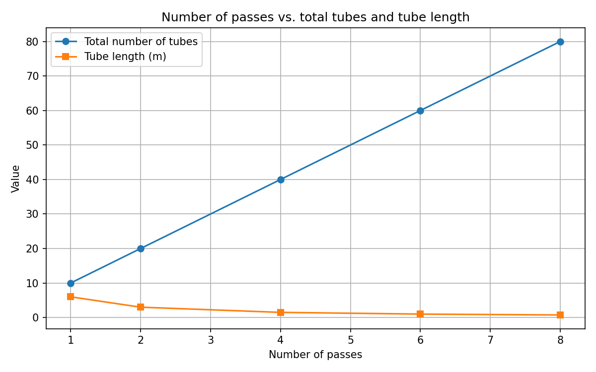
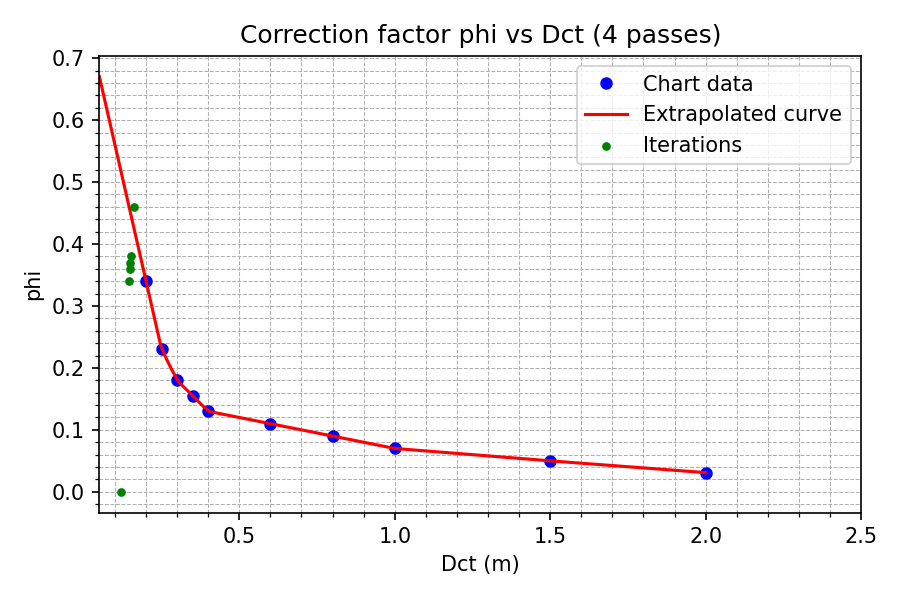

# Thermal Design and Performance Analysis of a High Heat-Flux Condensation System

Design of a horizontal **shell-and-tube condenser** that fully condenses water vapour entering at
**0.010627 MPa and 60 °C**, rejecting **43 kW** to cooling water that enters the tubes at **33 °C**.
The design covers the thermal sizing, tube layout, shell sizing, heat transfer coefficients and
the pressure drops on both sides, and is reproduced by a Python script.

Project at the University of Padova, supervised by Prof. Andrea Diani.

📄 **Full report:** [`report/Thermal-Design-High-Heat-Flux-Condensation-System.pdf`](report/Thermal-Design-High-Heat-Flux-Condensation-System.pdf)

## Final design

| Parameter | Value |
|---|---|
| Configuration | Horizontal shell-and-tube, condensation on the shell side, 4 tube passes |
| Tubes | 40 copper tubes, Ø 12.7 mm × 1.245 mm wall, 1.51 m each |
| Tube layout | 30° triangular pitch, p = 1.4·d = 17.78 mm |
| Bundle / shell diameter | 161.7 mm / 173.7 mm |
| Heat transfer area | 2.40 m² |
| Overall heat transfer coefficient | ≈ 2050 W/(m²·K) |
| Log mean temperature difference | 8.74 K |
| Flow rates | Water 1.14 kg/s · Vapour 0.018 kg/s |
| Tube-side pressure drop | 0.31 bar (limit 2 bar) |
| Shell-side pressure drop (Kern, vapour only) | ≈ 4.4 kPa |

The thermal duty is met with a compact 4-pass bundle. The shell-side pressure drop is close to the limit
for vacuum operation; a larger shell or double-segmental baffles would add margin.

## Method

1. **Design conditions**: saturation temperature 47 °C at the inlet pressure; cooling water outlet fixed
   at 42 °C (5 K approach); properties from REFPROP.
2. **LMTD** for isothermal condensation (correction factor F = 1).
3. **Tubes**: copper for its conductivity; water velocity within 1.2–1.8 m/s; tube count per pass from
   the required flow area, then tube length vs. number of passes. Four passes give the best compromise
   between length, tube count and pressure drop.
4. **Shell sizing**: bundle diameter found iteratively with the incomplete-packing correction factor φ,
   extrapolated below the chart's 200 mm range; shell-to-bundle clearance for a fixed tube sheet.
5. **Heat transfer**: Dittus–Boelter on the tube side; Nusselt film condensation on a horizontal tube with
   the N<sup>−1/6</sup> correction for condensate inundation in the bundle; overall coefficient with fouling
   and wall resistance. Two iterations on the wall temperature.
6. **Baffles**: spacing and maximum unsupported tube length checked against mechanical limits.
7. **Pressure drops**: Darcy–Weisbach plus concentrated losses on the tube side; Kern's method on the
   shell side for vapour-only and liquid-only flow, and a Lockhart–Martinelli two-phase estimate.

## Figures

| Tubes and length vs. passes | Bundle correction factor φ vs. D<sub>ct</sub> |
|---|---|
|  |  |

## Run the calculation

```bash
python -m pip install -r requirements.txt
python src/condenser_design.py          # prints all results, saves figures to figures/
python src/condenser_design.py --show   # also opens the figures
```

The script prints the tube/pass table, a summary of all calculated quantities and the Kern pressure-drop
breakdown. Values match the report to within rounding.

## Repository structure

```
├── report/
│   └── Thermal-Design-High-Heat-Flux-Condensation-System.pdf   full design report
├── src/
│   └── condenser_design.py                                     design calculation
├── figures/                                                    plots generated by the script
├── requirements.txt
└── README.md
```

## References

1. L. Rossetto, A. Cavallini, S. Bortolin, A. Diani, *Heat Transfer and Thermofluid Dynamics*, University of Padova, 2022.
2. NIST, *REFPROP: Reference Fluid Thermodynamic and Transport Properties Database*.
3. F. P. Incropera et al., *Fundamentals of Heat and Mass Transfer*, 6th ed., Wiley, 2007.
4. TEMA, *Standards of the Tubular Exchanger Manufacturers Association*, 9th ed., 2007.
5. C. Bonacina, A. Cavallini, L. Mattarolo, *Trasmissione del calore*.
6. D. Q. Kern, *Process Heat Transfer*, McGraw-Hill, 1950.
7. W. Nusselt, "Die Oberflächenkondensation des Wasserdampfes", *Z. VDI*, 60 (1916) 541–546.

## Author

**Kaleb Kassa Lafebo**, M.Sc. Energy Engineering, University of Padova.
[LinkedIn](https://www.linkedin.com/in/kaleb-kassa) · [GitHub](https://github.com/Kaleb-kass)
